 

 

  

 

<h3 align="center"><code>// LOADOUT</code></h3>

<table>
  <tr>
    <td align="right"><code>⚡ STREAMING</code></td>
    <td></td>
  </tr>
  <tr>
    <td align="right"><code>☸ PLATFORM</code></td>
    <td></td>
  </tr>
  <tr>
    <td align="right"><code>◈ WEB</code></td>
    <td></td>
  </tr>
  <tr>
    <td align="right"><code>⛓ ON-CHAIN · AI</code></td>
    <td></td>
  </tr>
</table>

 

<h3 align="center"><code>// ACTIVE MODULES</code></h3>

<table>
  <tr>
    <td width="50%" valign="top">
      <a href="https://github.com/aemendes/crossplane-provider-cloudflare"><b>🛰️ crossplane-provider-cloudflare</b></a> 
      Native Go Crossplane providers for Cloudflare Zero Trust: tunnels, DNS, access apps &amp; policies.
    </td>
    <td width="50%" valign="top">
      <a href="https://github.com/aemendes/crossplane-provider-neon"><b>🐘 crossplane-provider-neon</b></a> 
      Serverless Postgres as Kubernetes resources: Neon projects, databases and roles.
    </td>
  </tr>
  <tr>
    <td width="50%" valign="top">
      <a href="https://github.com/aemendes/forecasting_bitcoin_trend_using_twitter_sentiment"><b>📈 forecasting-bitcoin-trend</b></a> 
      My MSc thesis: predicting Bitcoin's trend from the sentiment of tweets.
    </td>
    <td width="50%" valign="top">
      <a href="https://github.com/aemendes/coinpayments-springboot"><b>💳 coinpayments-springboot</b></a> 
      Crypto payment gateway integration with Spring Boot.
    </td>
  </tr>
</table>

 

<h3 align="center"><code>// TELEMETRY</code></h3>

  

 

<picture>
  <source media="(prefers-color-scheme: dark)" srcset="https://raw.githubusercontent.com/aemendes/aemendes/output/github-snake-dark.svg" />
  <source media="(prefers-color-scheme: light)" srcset="https://raw.githubusercontent.com/aemendes/aemendes/output/github-snake.svg" />
  
</picture>

